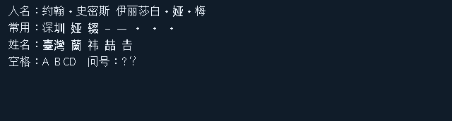

# 桌面小伴侣 · Touch349

[](https://github.com/fanzipei/desk-companion-touch349/actions/workflows/pc-tests.yml)
[使用指南](docs/usage.md) · [构建与开发](docs/development.md) · [新闻推荐](docs/news-personalization.md) · [微信接入](docs/wechat.md)

为 **Waveshare ESP32-S3-Touch-LCD-3.49 V2 / Rev1.1** 制作的桌面便签与新闻阅读器：Windows 原生托盘后台通过 BLE 与 640 × 172 横屏触屏通信。

这是独立的触屏版本仓库。`firmware/` 只构建这一款硬件，不包含非触屏屏幕驱动、非触屏固件目标或三按钮演示。固件、板级配置与组件都位于仓库内，构建不依赖其他项目目录；PC 连接前校验设备型号。



图片由实机帧缓冲导出，内容为合成的字形测试文字。

## 功能

- **便签**：选中文字按 `Ctrl+Alt+J` 发送；`Ctrl+Alt+空格` 打开输入框；`Ctrl+Alt+K` 框选截图并识别。便签默认最多 20 条，离线待发送操作持久保存。
- **触屏阅读**：空闲 10 秒进入全屏；操作界面双击正文立即全屏，进入后有 2 秒误触保护。单击退出全屏；上下拖动连续浏览，左右滑动切换条目。
- **自动播放**：正文向下缓慢滚动，开头停留 5 秒，底部停留 12 秒，跳回开头继续；不反向滚动。
- **操作**：全屏按住约 0.6 秒后左滑删除、右滑在 PC 打开。删除需要再点确认；也可用操作界面置顶、删除和切换模式。
- **方向与电源**：横屏倒转 180° 切换便签/新闻并转正显示、触摸；PWR 用于息屏/唤醒，RESET 保持复位，BOOT 不执行内容操作。
- **字形**：WQY 与 44,714 个 Noto Unicode 后备字形，支持 12/16/24/32 字号，修复人名“·”、常用缺字、繁体及特殊空格的问题。
- **新闻**：每 15 分钟收集 17 个 RSS 订阅，标题筛选阶段不抓正文；入选后抓取正文、翻译并生成中文长简讯。保留探索配额、主题和来源多样性。
- **模型**：推荐、翻译、简讯、偏好学习可独立选择商业 API、Ollama、Unsloth / 本地 OpenAI 兼容服务。
- **反馈**：置顶强于 PC 打开，删除为负反馈，滑动为辅助反馈；默认累计 20 条主动反馈后学习一轮，更新项目内的新闻偏好 skill。
- **新闻队列**：默认 30 条，可设 1–50。置顶保留，满额先淘汰最旧的已读未置顶新闻，再考虑未读。未读优先阅读，新增提示累计到手动关闭。
- **微信**：支持独立 ClawBot 便签接入；兼容共享中继时支持自动分发、微信取阅新闻和成功发送后同步已读。共享日历中继是可选外部集成，见[说明](docs/wechat.md)。

## 快速开始

准备上述 **V2 / Rev1.1** 开发板、USB 数据线和支持 BLE 的 Windows 10/11 PC。其他版本引脚不同，不能直接刷入。

```powershell
git clone https://github.com/fanzipei/desk-companion-touch349.git
cd desk-companion-touch349
powershell -ExecutionPolicy Bypass -File .\setup-pc.ps1
```

设备已运行本项目固件时，双击 `启动触屏小伴侣.bat`。在托盘打开“设置”，指定小屏 BLE 地址；同名设备并存时必须指定地址。PC 会在发送时间或内容前验证 `hardware=waveshare-touch-lcd-3.49-v2`。

首次需要[构建并刷入固件](docs/development.md)。本仓库不包含个人配置或便签；启动后在 PC 设置自己的模型与快捷键。在“新闻推荐”启用个性化 RSS，并配置各阶段模型：通常本地模型负责翻译和正文简讯，较强 API 模型负责推荐和偏好学习。本地服务失败时保留旧队列，不自动改用商业 API。

PC 平时只运行托盘图标，设置窗口关闭后后台继续运行。BLE 断开时设备仍显示已缓存内容；PC 恢复后补发持久化待发送便签、合并阅读与反馈。

## 仓库结构

```text
firmware/        唯一的 ESP-IDF 触屏固件目标及其组件
pc/              Windows Tkinter 托盘后台、BLE、新闻与微信接入
tests/           PC 单元测试、触屏状态逻辑和字形测试
tools/           构建、备份、缓存迁移和字体工具
docs/            安装、触控、模型、集成与开发文档
LICENSES/        第三方许可证和字体许可
```

## 数据与许可

`data/`、`logs/`、`backups/`、个人反馈 skill、模型密钥、微信凭据、设备 MAC、原始截图和完整 Flash 镜像均不随仓库发布。密钥与微信会话使用 Windows 用户 DPAPI 加密，运行时数据保存在当前克隆目录；两个克隆的数据互不共享。语音输入通过 Windows 自身能力，截图和新闻模型配置由本人选择。

原创代码采用 [Apache-2.0](LICENSE)。WQY 字体、Noto 后备字形、U8g2、LVGL 与微雪组件各自保留原许可，完整说明见 [THIRD_PARTY_NOTICES.md](THIRD_PARTY_NOTICES.md)；完整固件包含独立许可字体，不宣称为纯 Apache-2.0。新闻文章与用户内容不因此获得再分发授权。
